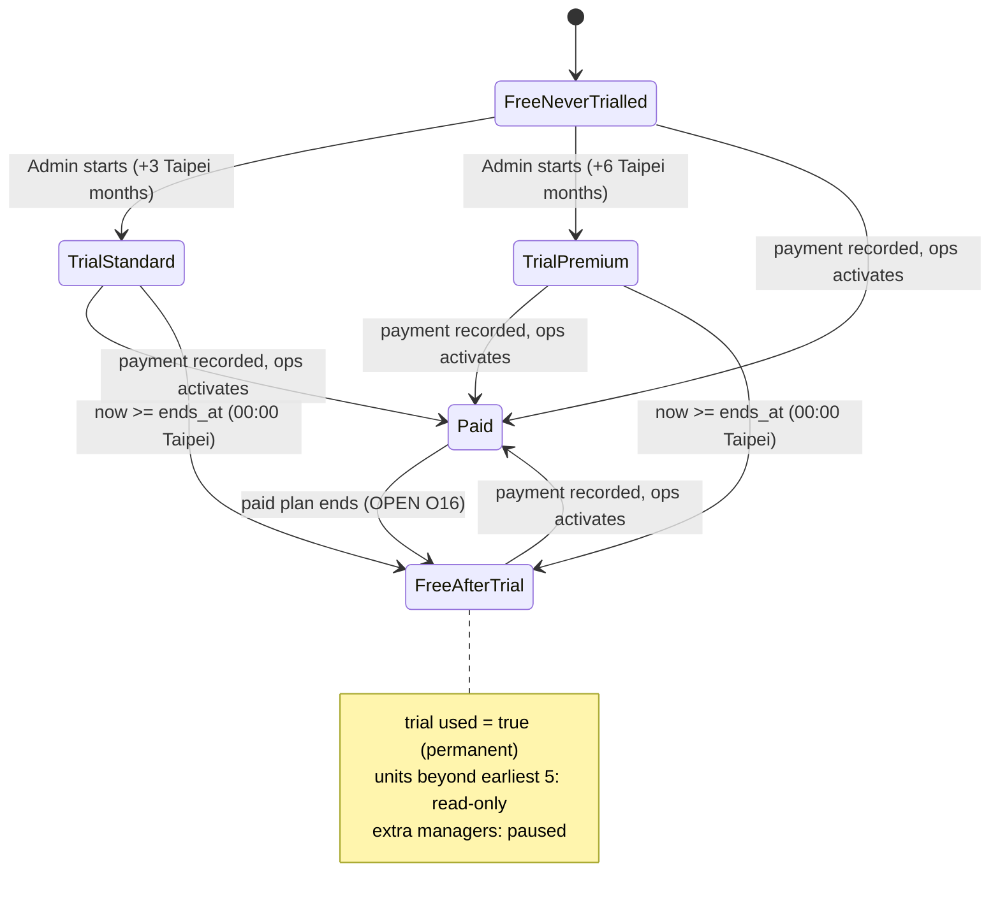

# ADR-111 — Trial engine state machine (B-056)

| | |
|---|---|
| Status | **PROPOSED (Phase 0 draft, needs Ron/CEO review)** |
| Date | 2026-11-13 PT |
| App SHA | `1e0a8ab` (GitHub `main`) |
| Requirement | hub `20-build/MAC-CLAUDE-HANDOFF-1112.md` §2.4; hub `20-build/specs/B-056.md` (MGT-96…MGT-99) |
| Supersedes (when accepted) | ADR-025 "Trial is three calendar months" — by a new row; ADR-025 is not edited |
| Related | ADR-110 (threshold), ADR-112 (new-table default), `docs/phase0/domain-model.md` §8, §11 |

Docs only. **Not the P37 design note** — it fixes the shape the design note must fill in. No table, column, function or flag name is final here. Schema statements are from migrations, not a live dump.

## Context

Rules already approved (B-056): one trial per org **across both plans** (R2=A); Standard +3 / Premium +6 **Asia/Taipei calendar months**; expiry at **00:00 Asia/Taipei** by a server job; back on Free, the **5 earliest-lease-start** units stay editable and the rest are read-only **on the server**; extra managers paused, accounts kept; in-app reminders at 14/3/1 days; **0 outbound**; paid plans activate only after payment.

Existing pieces that conflict:

| Piece | Today | Evidence |
|---|---|---|
| `organizations.settings.plan = {tier, trialUntil}` | untyped JSON; the de-facto plan + trial record | `src/server/signup.ts:653`; `src/server/sandbox-data.ts:177-183` |
| `requestUpgrade` | Admin-only; **on every call** sets `tier` to the paid tier **immediately** and overwrites `trialUntil = now() + N months`; owner path (`withClient`), audit written after `COMMIT` | `src/server/partners.ts:293-335` |
| `hasPlanOrTrial` | true for any tier `standard`/`pro`/`business` regardless of date — nothing returns an org to Free | `sandbox-data.ts:185-189` |
| `partner_codes.trial_months` → `firm_partner_prices.trial_months` | default 3; second source of trial length, same for both tiers | `supabase/migrations/20261022120000_self_serve_signup.sql:37,63` |
| `app.b030_subscriptions` | second state machine (`trialing`/`active`/`grace`/`restricted`/`canceled`), provider-driven, mock only; flag `usage_subscriptions` OFF | `20261107070000_b030_usage_subscription_state.sql:27,161-167`; `ops/flags.yaml:444-451` |
| Plan vocabulary | enum `plan_tier` = `beta`/`free`/`pro`/`business` (no `standard`); code tiers `standard`/`pro`; copy Standard/Premium with internal key `pro` | `20261018120000_schema.sql:86`; `billing.ts:14`; `b045-pricing-interim-rules.ts:140` |
| Scheduler | two crons only: 09:00 and 03:00 Asia/Taipei. None at 00:00 | `wrangler.jsonc:62,106`; `custom-worker.mjs` |
| Unit cap / read-only | none: `overFree` has no caller; no per-unit editability | domain-model §8 gap 4, §2 |
| Manager pause | `org_members.status='suspended'` exists but carries no cause | domain-model §1 |
| `?trial=` | built by `trialCtaHref`, read by nothing | `b045-pricing-interim-rules.ts:276-283` |
| Outbound | a real email path is live-capable on staging/prod | `architecture-map.md` §9 |

## Decision drivers

1. One-trial and pay-then-activate must be enforced by the database, not by a JSON overwrite.
2. Correct at 00:00 Asia/Taipei even if a cron is late, skipped, or run twice.
3. Read-only must hold on every write path (`tx`, `svc`, owner path), not only in the UI.
4. Flag OFF = today's behaviour unchanged; 0 outbound in every path.
5. Do not change `plan_tier`, `FREE_UNITS`, or B-030 while building this.

## Proposed state machine (per org)

"Trial used" is a permanent fact set on the first start; no transition leads back to `FreeNeverTrialled`. Reminder thresholds (14/3/1) and banner dismissals are **presentation state**, not machine states.

## Options — expiry mechanism

**A. New cron at 16:00 UTC (00:00 Asia/Taipei) only.** State flips when the job runs. Consequence: a late or failed run leaves an expired org on paid rules; a third cron trigger changes shared Worker config (box-PE-owned) and plan cron limits are **unverified**.

**B. Lazy evaluation only.** Effective plan = pure function of stored `ends_at` and `now`, computed on every read and every guarded write; no job. Consequence: always correct at the instant; but nothing "happens" at expiry — no audit row, no manager pause record, and B-056 AC wording ("a server job returns the org to Free") is not literally met.

**C. Both (recommended).** Lazy evaluation is the **source of truth** for access; an idempotent job only **materialises** side effects (audit row, pause record, expired-banner state). Job trigger is OPEN: new 16:00 UTC cron, or piggyback on the existing 03:00 / 09:00 crons (up to 3–9 h late, harmless because access is already lazy).

## Options — where trial state lives

1. **Keep extending `settings.plan` JSON.** No migration; but no uniqueness, no history, concurrent overwrite — fails driver 1.
2. **New dedicated trial record, one row per live org, with a uniqueness guarantee (recommended; names OPEN, proposed: a trial table in schema `app` keyed by org).** `settings.plan.trialUntil` becomes a compatibility field written by the engine or is no longer read after cut-over.
3. **Use `app.b030_subscriptions.trialing`.** One state machine long-term; but B-030 is OFF, mock-only, provider-sequenced, and has no "ever used" concept. Couples B-056 to an unshipped feature.

## Recommended option

Expiry **C**, storage **2**, and:

- **Effective-plan resolver in one place** (Free / trial-with-paid-rules / paid), used by seat cap, unit guard, usage card and banners. Replaces scattered `planSnapshot` / `hasPlanOrTrial` / `seatLimit` reads **only when the flag is ON**.
- **`requestUpgrade` unchanged when the flag is OFF.** With the flag ON it must neither set a paid tier nor write `trialUntil`; paid activation comes only from the ops queue after 入帳 (`pricing_apply_requests.paid_received_on`).
- **Read-only via one server guard** called by every management-side write that targets a unit or its leases; tenant app paths never call it (MGT-99-AC3). Whether a DB trigger backs it up is OPEN (O17).
- **Manager pause computed from the effective plan**, not by mutating `org_members.status`, so a manually deactivated member is never "resumed" by an upgrade.
- **Reminders are render-time banners** from `ends_at`; dismissals stored per org/threshold. No call into `mail.ts`, LINE transport or the reminders cron.
- **Independent of B-030**; plan key for Premium stays `pro` internally unless Q-H says otherwise; `plan_tier` enum untouched.

## Consequences

- One schema PR (new table, post-INC-RLS default per ADR-112) and one guard that many write paths must call — the guard's call-site inventory is the main review cost.
- `ends_at` is computed once at start in Asia/Taipei calendar months (e.g. start 11/30 + 3 months → end-of-February rule must be specified, O18).
- Existing orgs with a non-null `trialUntil` need an aggregate-only inventory before cut-over (O10).
- ADR-025 is superseded by a new row when this ADR is accepted.

## Cases the design note must cover

| Area | Cases |
|---|---|
| Concurrency | two Admins start at once (exactly one row, one audit); start racing paid activation; job run twice / overlapping; expiry racing a paid activation at 00:00; a lease starting or ending while the editable set is computed; `requestUpgrade` (old path) racing the new start |
| Permission | non-Admin start (403, server); sandbox vs live org; cross-org org id in the request; platform admin activating paid; paused manager with a live session at expiry; "original Admin" with several admins |
| Failure | job fails mid-batch (resume, no double side effects); DB error during start (nothing written, no banner); clock/timezone (DB session TZ ≠ Asia/Taipei); flag turned OFF mid-trial (old behaviour returns; state kept, not deleted); `?trial=` with an invalid or repeated value; signup with `trial=` for an already-trialled org (MGT-96-AC4) |
| Read-only | direct POST/server-action to edit unit #6; new lease on a read-only unit; export still allowed; `svc()` and owner-path writers; tie on lease start date |
| Outbound | every path asserts zero sends (capture sink empty) |

## What this ADR does NOT decide

Carries `domain-model.md` §11.3 O1–O15 unchanged (owners there). Additional:

| # | Open question | Owner |
|---|---|---|
| O4 | Job trigger: new 16:00 UTC cron vs piggyback on 03:00/09:00 (shared Worker config, cron limits unverified) | CEO, with box PE |
| O7 | Who is "the original Admin" kept on expiry | Ron, via CEO |
| O9 | Editable set of 5: frozen at expiry or recomputed as leases change | Ron, via CEO |
| O15 | Exactly which management actions "read-only" blocks | Ron, via CEO |
| O16 | What happens when a paid plan ends or is cancelled (same read-only rules?) | Ron, via CEO |
| O17 | DB-level backstop (trigger) for read-only, or server guard only | CEO (security review) |
| O18 | Month-end arithmetic for +3/+6 calendar months | CEO (confirm with Ron if user-visible) |
| O19 | Does a partner code's `trial_months` still apply, and does it consume the one trial | Ron, via CEO |
| O20 | Names: table/columns/functions, flag key under `pricing_trial*` | CEO, in design-note review |

## Implementation sketch

| PR | Content | Gate |
|---|---|---|
| PR-0 | P37 design note (answers O-items, production checklist, call-site inventory) | CEO review before any code |
| PR-1 **schema/RLS** | trial record + dismissal state; additive only | **non-author QA + CEO exact-SHA GO before any staging apply**; box PE orders migrations |
| PR-2 | effective-plan resolver + start action + flag registration (default OFF) | Class B + security review |
| PR-3 | read-only guard + manager pause | Class B + security review |
| PR-4 | expiry job (idempotent) — any cron change is shared config | box PE + CEO GO |
| PR-5 | usage card, confirm, banners per mockup `b73680e` | P52 confirm (B-056 OPEN) |

First ON: Ron's 4 internal orgs only, after QA and a CEO exact-SHA GO.

## Verification

Per GLOSSARY "Verify" — real interface, real input, on staging with synthetic orgs:

1. Admin starts a Standard trial on `/m/settings`; card shows the end date; a second start (either plan, UI or direct request) is refused.
2. Set the synthetic org's end to the past: without running the job, a direct edit request for unit #6 is refused and units 1–5 by lease start succeed; the tenant app for unit #6 still reports a payment.
3. Run the job twice: one audit row, one expired banner, no duplicate pause effect.
4. Second manager cannot open `/m`; after ops marks paid, access returns without touching a manually suspended member.
5. Capture sink and `email_log` show zero new sends for the whole run (counts only).
6. Flag OFF on the same SHA: `/m/settings`, `/m/upgrade`, `requestUpgrade` behave as at `1e0a8ab`.
