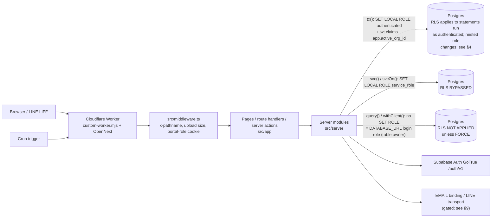

# Phase 0 — Architecture map

| | |
|---|---|
| App SHA | `1e0a8ab` (GitHub `main`, merge of PR #131) |
| Date | 2026-11-13 PT |
| Author | Mac Claude (Phase 0 draft, Fable) |
| Status | **DRAFT for CEO review** — docs only; no code, migration, flag or config changed |
| Requirement | hub `20-build/MAC-CLAUDE-HANDOFF-1112.md` §2.1 |
| Refreshes | `docs/ARCHITECTURE.md` (baseline `5d8b002`, stale) — that file is left untouched |

**Evidence rules used in this document**

- Every number was re-counted on the worktree at `1e0a8ab` (method given next to the number).
- Every schema statement is **from migrations/docs, not a live schema dump**. No live database, Worker, or Cloudflare/Supabase console was read.
- "unverified" marks anything that could only be confirmed against a live system.
- Before building anything, read hub `INDEX.md` § "Do NOT build" (`INDEX.md#do-not-build`). It is linked, never copied.
- Terms follow hub `GLOSSARY.md`: 管理方 app `/m`, 租客 app `/t`, 屋主 app `/o`, 廠商 app `/v`, B 項, Class A/B, 功能旗標, verdict.

---

## 1. Runtime and deploy

| Item | Value | Evidence |
|---|---|---|
| Framework | Next.js 15.5.28, React 19.1.0 | `package.json` |
| Adapter | `@opennextjs/cloudflare` ^1.20.12, `wrangler` ^4.151.2 | `package.json` |
| Worker entry | `custom-worker.mjs` wraps `.open-next/worker.js` (`fetch`) and adds `scheduled()` | `custom-worker.mjs`, `wrangler.jsonc` `main` |
| Worker names | default `condola`; staging env → `condola-staging` (`workers_dev: true`); production env `condola-prod` (`workers_dev: false`, custom domain `app.condola.app`) | `wrangler.jsonc` |
| Compatibility | `compatibility_date` 2026-10-01, `nodejs_compat` | `wrangler.jsonc` |
| Placement | targeted, `aws:ap-northeast-1` (both envs) | `wrangler.jsonc` |
| Toolchain pins | Node 20.20.2 / npm 10.8.2; Node 22.23.5 for the wrangler lane | `ops/toolchain.json`, `.nvmrc` |
| Marketing site | separate Worker (`condola-site`); not in this repo | handoff §2.1 — unverified here |

**Bindings** (`wrangler.jsonc`): `ASSETS` (`.open-next/assets`), `WORKER_SELF_REFERENCE` (service binding to self), `EMAIL` (`send_email`, `remote: true`, staging and production). Font `.ttf` files are bundled as Data modules and exposed on `globalThis.__CONDOLA_FONTS` (`custom-worker.mjs`).

**Vars** (non-secret, `wrangler.jsonc`): `CONDOLA_ENV` (`staging` / `production`), `CONDOLA_SITE_URL`, `DEMO_MODE=false`, `LINE_LOGIN_ENABLED=false`, `MAIL_PROVIDER=cloudflare`; production also `BRAND_V2=true`, `STAGING_AUTODEPLOY=false`.

**Required secret NAMES** (8, both envs; values never in repo): `DATABASE_URL`, `SUPABASE_URL`, `SUPABASE_ANON_KEY`, `SUPABASE_SERVICE_ROLE_KEY`, `ID_DOC_ENCRYPTION_KEY`, `ID_DOC_HMAC_KEY`, `ID_DOC_SIGNING_SECRET`, `CRON_SECRET`.
Other secret-like names read by code but not in the required list: `B030_MOCK_PROVIDER_HMAC_SECRET`, `ESIGN_EMAIL_SECRET`, `LINE_CHANNEL_SECRETS`, `UNIT_QR_SIGNING_KEY` (must never be set — handoff §5), `BREVO_API_KEY`, `RESEND_API_KEY`. Whether any is set on a live Worker is **unverified**.

**Crons** (`wrangler.jsonc` `triggers.crons`, both envs; dispatch in `custom-worker.mjs`):

| Cron (UTC) | Asia/Taipei | Route called | Guard |
|---|---|---|---|
| `0 1 * * *` | 09:00 | `POST /api/cron/reminders` | header `x-cron-secret` = `CRON_SECRET`; skipped with a warning if the secret is missing |
| `0 19 * * *` | 03:00 | `POST /api/cron/purge-id-documents` | same header; work also gated by a `platform_settings` mode (`off` / `dry_run` / `on`, `docs/DEPLOY.md`) — `ID_PURGE` stays OFF (handoff §5) |

There is **no cron at 00:00 Asia/Taipei (16:00 UTC)**. B-056 expiry needs a scheduling decision (see §13 G6).

**Deploy.** Staging: `scripts/cf-deploy-staging.sh` (`opennextjs-cloudflare deploy --env staging`), preceded by `scripts/preflight-deploy.sh` per QA-STANDARD. Production is manual and box-PE-only (`docs/DEPLOY.md`; handoff §4). The Mac holds no production keys.

**Request path**

---

## 2. App surfaces

Counted with `find src/app -name page.tsx` and `-name 'route.ts*'` at `1e0a8ab`.

| Surface | Pages | Route handlers | Notes |
|---|---|---|---|
| 管理方 app `/m` | 52 | — | `src/app/m`; permission map in `src/server/perms.ts` |
| 租客 app `/t` | 13 | — | `src/app/t` |
| 屋主 app `/o` | 10 | — | `src/app/o` |
| 廠商 app `/v` | 4 | — | token pages only: `/v/[token]`, `/v/[token]/estimate`, `/v/[token]/notifications`, `/v/documents/[token]` |
| `(line)` group | 0 | 4 | LIFF entry: `/t/liff`, `/o/liff`, `/v/liff`, `/v/liff/job` |
| `/api` | — | 65 | 36 top-level groups under `src/app/api` |
| Public / auth / other | 25 | 7 | `/login`, `/signup`, `/forgot`, `/reset`, `/auth`, `/accept`, `/join`, `/consent`, `/partner-*`, `/pricing`, `/terms`, `/privacy`, `/refund`, `/licenses`, `/walk`, `/vendor-account`, root |
| **Total** | **104** | **76** | Baseline `5d8b002` had 76 pages / 28 routes |

Server-action files: 26 files start with `"use server"` (31 contain the directive anywhere).
`src/middleware.ts` does no auth: it sets `x-pathname`, rejects oversized ID/photo uploads (413), expires env-choice cookies on `/auth/enter`, and sets the portal-role cookie for `/o` and `/t`. Authorization happens in server modules.

---

## 3. Server module map by domain

`src/server` holds 582 entries (271 non-test top-level modules). Anchor files: `actions.ts` (897 lines), `queries.ts` (2083), `domain.ts` (2814), `auth.ts` (1587), `db.ts` (272).

| Domain | Main modules (`src/server/…`) |
|---|---|
| Data access | `db.ts`, `org-guard.ts`, `org-scope.ts`, `errors.ts`, `after-response.ts` |
| Auth / session / identity | `auth.ts`, `auth-actions.ts`, `session.ts`, `password.ts`, `totp.ts`, `lockout.ts`, `reset-limit.ts`, `signup*.ts`, `portal-login.ts`, `portal-invite.ts`, `portal-resend*.ts`, `team-invites.ts`, `identity.ts` |
| Org, roles, permissions | `perms.ts`, `b017-*` (custom roles), `seats.ts`, `platform.ts`, `staff-profile*.ts`, `sandbox*.ts`, `env-actions.ts` |
| Property / unit / room | `portfolio.ts`, `import-*.ts`, `owner-import.ts`, `unit-line-invite*.ts`, `unit-qr-*.ts` (must stay OFF) |
| Lease / tenant | `lease-form.ts`, `lease-rules.ts`, `lease-target.ts`, `official-lease.ts`, `paper-lease-versions*.ts`, `renewal-comparison*.ts`, `move-in-*.ts`, `move-out-notice.ts`, `b002-move-out-actions.ts`, `handover*.ts`, `tenant-*.ts`, `esign/` |
| Owner | `owner-scope.ts`, `owner-net-ledger*.ts`, `owner-transfers.ts`, `owner-finance-replies*.ts`, `owner-billing-profile-rules.ts`, `statement-*.ts` |
| Vendor / work order | `repairs.ts`, `repair-*.ts`, `vendor-*.ts` (22 modules), `job-types-rules.ts`, `ticket-photos.ts` |
| Money flow | `money.ts`, `monthly-*.ts`, `first-*.ts`, `period-due-components.ts`, `bank-matching*.ts`, `payee*.ts`, `payment-*.ts`, `deposit-*.ts`, `expenses.ts`, `utility-*.ts`, `income-expense.ts`, `invoice-number.ts` |
| Notifications / LINE / email | `notification-*.ts`, `reminder*.ts`, `manual-reminders.ts`, `local-reminder-capture.ts`, `outbound.ts`, `mail*.ts`, `staff-email-*.ts`, `recipient-channels*.ts`, `line/` (19 modules) |
| Plans / usage / pricing | `billing.ts`, `billing-preview-*.ts`, `partners.ts`, `partner-controls*.ts`, `upgrade-gate.ts`, `pricing-interim.ts`, `b045-pricing-interim-rules.ts`, `pricing-apply-actions.ts`, `usage-events.ts`, `usage-subscriptions.ts`, `b030-subscription-rules.ts` |
| Audit / consent / legal | `audit*.ts`, `consent*.ts`, `partner-consent*.ts`, `legal*.ts`, `privacy.ts`, `record-archive*.ts` |
| ID documents / files | `id-*.ts` (10 modules), `upload-recovery*.ts`, `pdf-*.ts`, `signed-pdf-http.ts`, `backup.ts` |
| Flags (per feature, no shared evaluator) | `flag-registry-sql.ts` (test-side scanner only), `brand-v2.ts`, per-feature readers listed in §7 |

---

## 4. Data-access layer — when RLS applies (critical)

All SQL goes through `src/server/db.ts`. One `pg` `Client` per operation (no pool; Workers close sockets at request end, `db.ts:84-103`). The login role is whatever `DATABASE_URL` names.

| Helper | What it does | Postgres role in effect | RLS |
|---|---|---|---|
| `query(sql, params)` (`db.ts:146`) | one statement on a fresh client, **no** `BEGIN`, **no** `SET ROLE` | login role of `DATABASE_URL` | **Not applied** when that role owns the table, unless the table has `FORCE ROW LEVEL SECURITY` |
| `withClient(fn)` (`db.ts:89`) | hands the raw client to `fn`; caller may open its own transaction | same login role | **Not applied** (same rule) |
| `withDeferredClient` (`db.ts:110`) | as `withClient`, plus one statement run after the response | same login role | **Not applied** |
| `tx(userId, fn, scope?, options?)` (`db.ts:189`) | `BEGIN`; sets `request.jwt.claim.sub`, `request.jwt.claim.role='authenticated'`; pins `app.active_org_id` and `app.env`; `SET LOCAL ROLE authenticated`; `COMMIT` | `authenticated` **initially** (the caller role of `fn`'s own statements) | **Applied to statements that run as `authenticated`** — policies see `auth.uid()` and the pinned org/environment. Nested operations can run with other authority (facts 2–3 and the role table below) |
| `svc(userId \| null, fn)` / `svcOn(client, …)` (`db.ts:250-272`) | `BEGIN`; jwt role `service_role`; `SET LOCAL ROLE service_role`; `COMMIT` | `service_role` | **Bypassed** if `service_role` has BYPASSRLS — the code comment (`db.ts:244-248`) and the local stub (`supabase/stub/supabase_stub.sql:63`) say so; the hosted role attribute is **unverified**. Caller must authorize first |

Facts that follow from the code and migration headers:

1. **`query()` / `withClient()` are an owner path.** The INC-RLS-1112 migration header states it directly: such SQL "runs as the table owner, which bypasses RLS unless RLS is FORCED" (`supabase/migrations/20261112100000_advisor_rls_stop_bleed.sql:4-5`). `docs/STAGING.md:34` documents the runtime user as `postgres.<project-ref>`. The live role and its attributes are **unverified**.
2. **`tx()` sets the *initial* role only.** It is the one helper whose own statements run as `authenticated` and are therefore filtered by policies (database-enforced org isolation for those statements). It does **not** guarantee that every nested operation stays under RLS:
   - **Usage recording switches role inside the same transaction.** `tx()` wraps `fn` in `withUsageTransaction` (`db.ts:226`); the usage recorder opens a savepoint, runs `SET LOCAL ROLE service_role` plus the matching jwt claim, calls `app.prop07_record_usage`, then restores the previous role and claim (`src/server/usage-events.ts:56-75`). `svcOn()` and `bank-matching.ts:37` use the same wrapper.
   - **A `SECURITY DEFINER` function runs with its owner's authority**, whatever the caller role is (436 occurrences, §5). Rows it reads or writes are checked against the **owner**, not against `authenticated`.
   - **`SECURITY DEFINER` does not by itself bypass `FORCE ROW LEVEL SECURITY`.** Whether the function sees rows depends on the function owner's role attributes (superuser / BYPASSRLS), whether that owner is the table owner, and which policies apply to that owner. A forced table with no policies denies a table owner that has neither attribute.
   Everything on the owner path or `svc()` relies on server code (`requireOrgScope`, `assertSameOrg`, `assertStaff`, `assertPerm`, explicit `WHERE org_id = $n`).
3. **`tx()` scope has three modes** (`db.ts:196-224`): `{orgId, environment?}` pins that org; `{pin:false}` pins nothing (sandbox rows stay hidden); **no scope** falls back to resolving the caller's live firm from cookies/membership — a comment says request paths must pass `requireOrgScope(session)` or use `txForSession` (`org-guard.ts:6,23`), and the fallback is meant for seed/cron.
4. **`FORCE` matters on the owner path.** 22 tables are forced by explicit statements plus 5 e-sign tables forced in a loop (`20261030150900_esign_core.sql:434-440`); on those, owner-path SQL is subject to policies **unless the login role is a superuser or has BYPASSRLS (hosted attributes unverified)**, so the code uses `svc()` or `SECURITY DEFINER` functions instead. Example: `public.pricing_apply_requests` is `ENABLE` + `FORCE` with no policies, and `app.submit_pricing_apply` is `SECURITY DEFINER`; the migration comment says "SECURITY DEFINER to bypass FORCE RLS (owner)" (`20261112010000_b045_pricing_interim.sql:43-64`). That comment holds only if the function owner has an attribute that bypasses RLS — see fact 2 and the role table. Whether it holds on staging/production is **unverified**.
5. **Local and CI databases use a SUPERUSER login** (`scripts/db-setup.sh:15`; CI `POSTGRES_USER`), and that same superuser applies the migrations, so it **owns every table and every function**. A superuser ignores RLS even when forced. Consequences — no blanket claim that local tests reproduce hosted behaviour:
   - owner-path behaviour against forced tables is **not** reproduced locally;
   - `SECURITY DEFINER` functions are superuser-owned locally, so what they can read or write under RLS is **not** reproduced locally;
   - a local `tx()` test is evidence only for statements issued directly as `authenticated` (grants + policy logic). It is not evidence for the nested `service_role` switch or for any definer function called inside it;
   - a local `svc()` test is evidence only as far as the stub's `service_role` (`NOLOGIN NOINHERIT BYPASSRLS`, `supabase/stub/supabase_stub.sql:63`) matches the hosted role — **unverified**.

**Caller role and function-owner role, per path.** "Function owner" = the role that ran the migration, unless the migration says `ALTER FUNCTION … OWNER TO` (one case found: `20261104120400_b009_bank_match_owner.sql:45`, `OWNER TO CURRENT_USER`).

| Path | Caller role (the helper's own statements) | Authority changes inside the helper | Function-owner role for `SECURITY DEFINER` calls | RLS result |
|---|---|---|---|---|
| `query()` / `withClient()` / `withDeferredClient()` | `DATABASE_URL` login role. Local/CI: superuser `condola`. Hosted: documented as `postgres.<project-ref>` (`docs/STAGING.md:34`); attributes **unverified** | none set by the helper; the caller may run its own `SET ROLE` | migration role. Local/CI: the same superuser. Hosted: **unverified** | not applied when the caller owns the table, unless forced; forced tables apply policies to a caller without superuser/BYPASSRLS |
| `tx()` | `authenticated` (non-login role, set by `SET LOCAL ROLE`) | usage recording: temporary `service_role` inside a savepoint (`usage-events.ts:56-75`) | migration role (as above) | policies apply to `authenticated` statements only; the `service_role` step and definer functions follow their own role |
| `svc()` / `svcOn()` | `service_role` | usage recording keeps `service_role` | migration role (as above) | bypassed if `service_role` has BYPASSRLS (hosted **unverified**); definer functions follow their owner |

Hosted role attributes (superuser, BYPASSRLS, table and function ownership) were **not read** for this draft and stay **unverified** (G15; ADR-112 Q7/Q8).

Call-site counts (regex over `src/**/*.ts(x)`, test and fixture files excluded, definitions included): `tx(` 163 in 48 files · `svc(` 159 in 38 files · `svcOn(` 6 in 4 files · `query(` 110 in 23 files · `withClient(` 42 in 22 files · `txForSession(` 2.

---

## 5. Database and migrations

*All of this section is from migrations/docs, not a live schema dump.*

| Item | Value | Method |
|---|---|---|
| Migration files | 160 in `supabase/migrations` (62 at baseline; 98 added, 12 early files changed by a 1-line removal each) | `ls`, `git diff --name-status 5d8b002 HEAD` |
| First / last | `20261018120000_schema.sql` … `20261112100000_advisor_rls_stop_bleed.sql` | `ls` |
| Tables created | 229 = **111 `public`** + **118 `app`** | `CREATE TABLE` regex, SQL comments stripped |
| Persistent `DROP TABLE` | none (only `pg_temp.*` and one scratch table created and dropped inside the same migration) | regex |
| Apply tool | `scripts/db-migrate.sh` → records in `condola_ops.schema_migrations`; refuses port 6543 | script |
| Runtime vs migration connection | runtime: transaction pooler 6543; migrations: session 5432 | `docs/STAGING.md:27-36` |
| Local auth stub | `supabase/stub/supabase_stub.sql` — local/CI only, never hosted | `docs/STAGING.md:25` |

(The handoff says 112 public tables; the recount here is 111. The difference is not explained — treat both as approximate until a live `\dt`.)

**Schemas.** `public` holds the original domain tables (61 in the initial schema) plus later additions. `app` holds helper functions (`app.is_member`, `app.has_role`, `app.is_property_owner`, `app.is_lease_tenant`, `app.my_contact_ids`, …) and, since the B-series, feature tables prefixed by B 項 (`app.b008_*` … `app.b039_*`), plus `app.unit_*`, `app.handover_*`, `app.deposit_settlement_*`, `app.repair_cost_*`, `app.usage_events`. `authenticated` and `service_role` have `USAGE` on schema `app` (initial schema).

**RLS footprint**

| Measure | Count |
|---|---|
| `ENABLE ROW LEVEL SECURITY` statements | 138 (136 distinct tables: 45 public + 91 app) |
| Initial schema loop | enables RLS on every `public` table existing at that point (61) — `20261018120000_schema.sql:2030-2035` |
| `public` tables without RLS enabled (by migration text) | 0 after INC-RLS-1112 |
| `app` tables with no explicit `ENABLE` | 27 — each has a `REVOKE ALL … FROM … authenticated` statement (regex check; **needs live verification**) |
| `FORCE ROW LEVEL SECURITY` | 23 statements (22 tables) + 5 e-sign tables via loop |
| `CREATE POLICY` / `DROP POLICY` | 148 / 49 |
| `SECURITY DEFINER` occurrences | 436 outside comments (458 including comments) |
| RPC allowlist | `supabase/rpc-allowlist.txt`, enforced by `scripts/check-function-privileges.sh` (`npm run test:fn-priv`) |

**INC-RLS-1112 (stop-bleed).** Migration `20261112100000_advisor_rls_stop_bleed.sql`:

- Seven tables created after the initial loop had no RLS and carried Supabase's default grants: `partner_codes`, `firm_partner_prices`, `firm_price_overrides`, `signup_verifications`, `signup_drafts`, `funnel_events`, `upgrade_requests`.
- Fix: `ENABLE RLS` with **no policies and not forced** (the app reaches them on the owner path), and `REVOKE ALL … FROM anon, authenticated`.
- Views `tenant_lease_picker` and `owner_lease_tenants` set to `security_invoker = true`; the latter's body moved behind `SECURITY DEFINER` function `app.owner_lease_tenants()`.
- Data fix: unused signup verification tokens expired by `UPDATE` with one count-only audit row.

**Standing rules (non-negotiable, handoff §2.1 and §5):**

1. Never restore the exposed grants.
2. Never disable RLS. Fix forward.
3. Tokens in `signup_verifications` are expired by `UPDATE`, never `DELETE`.
4. Never print row values; aggregates only.

---

## 6. Environments

| Env | Worker | DB | Who deploys |
|---|---|---|---|
| Local | `next dev` on :43123 or built Worker in tests | disposable local PG16, SUPERUSER role, `DEMO_MODE=true` | developer |
| Hosted CI | none | `postgres:16` service container | GitHub Actions |
| Staging | `condola-staging` | Supabase Tokyo project (ref prefix per handoff) | Mac for its own items after QA (R5); box PE owns shared config and migration ordering |
| Production | `condola-prod` @ `app.condola.app` | Supabase Tokyo project | box PE only, after CEO exact-SHA GO, T+0/T+15 |

Org-level environment is separate from deploy environment: `organizations.environment` is `live` or `sandbox`, a sandbox org points at its live org (`organizations_environment_shape` CHECK, `20261020180000_sandbox.sql`), and `tx()` pins `app.env` so RLS separates the two.

---

## 7. Flags

Three layers exist; they are not unified.

| Layer | Where | Role |
|---|---|---|
| Registry | `ops/flags.yaml` — **56 keys**; 54 expire `2026-11-24T18:00 PT`, 2 (`unit_line_invite`, `pricing_interim`) `2026-12-10T18:00 PT` | owner, expiry, ring, documented kill/override. Its first line says older registry reconciliation "remains incomplete" |
| Runtime, DB | `platform_settings` row (`{"enabled":bool,"allowed_org_ids":[…]}`) and/or `organizations.feature_flags.<key>` | per-org admission. **Not one universal scheme** — each feature has its own rule (patterns below) |
| Runtime, env | Worker vars read via `process.env` | usually a global switch; **not always a kill switch** (`BRAND_V2`, below) |

**Evaluation patterns found (not exhaustive — a full per-flag inventory is still owed, ADR-113):**

| Pattern | Rule | Example |
|---|---|---|
| Strict platform + allowlist + org | platform setting `enabled === true` **and** org id on `allowed_org_ids` **and** `feature_flags.<key> === true`; anything malformed = OFF | `pricingInterimOn` (`b045-pricing-interim-rules.ts:54-68`); SQL twin `app.b030_enabled` |
| Three-state platform value | setting is `"off" \| "org" \| "on"`. `"on"` admits every org **unless** the org override is `false`; `"org"` admits only orgs whose override is `true` | partner consent gate (`partner-consent-rules.ts:30-36`) |
| Env **OR** org opt-in | `BRAND_V2 === "true"` turns it on for everyone; otherwise `feature_flags.brand_v2 === true` turns it on for that org. Setting the env var to `false` does **not** switch off opted-in orgs | `brand-v2.ts:25-49` |
| Env switch and/or env allowlist | per feature | names listed below |

**There is no central evaluator.** 44 non-test files under `src` reference `feature_flags` and 45 reference `platform_settings`; each feature carries its own reader. `flag-registry-sql.ts` is a test-side SQL scanner, not a runtime API. The expiry check lives in `scripts/gate.sh` (step `flag-expiry`, using `scripts/flag-expiry-policy.cjs`); hosted `ci.yml` has no separate flag-expiry step.

**Env switches found in code** (most act as kill switches; `BRAND_V2` does not — see the table above): `ESIGN_ENABLED`, `IMPORT_ERROR_DETAILS_ENABLED`, `TENANT_SIGNED_PDF_ENABLED`, `PAPER_LEASE_VERSIONS_ENABLED`, `MOVE_OUT_NOTICE_ENABLED`, `LINE_PLATFORM_ENABLED`, `LINE_LOGIN_ENABLED`, `LINE_PUSH_QUOTA_GUARD`, `BRAND_V2`, `B030_MOCK_PROVIDER_ENABLED`, `DEMO_MODE`, and allowlists `CUSTOM_ROLES_ORG_ALLOWLIST`, `TEAM_INVITES_ORG_ALLOWLIST`, `CONDOLA_PLATFORM_ADMIN_EMAILS`.

**Mismatches (from the inventory, spot-checked):**

| Kind | Items |
|---|---|
| Used in code, absent from `flags.yaml` | `brand_v2`, `vendor_dispatch`, `go_live_lock`, `design_partner_consent_gate`, `esign_disposal_enabled` |
| In `flags.yaml`, referenced only from SQL/tests | `unit_qr_signup`, `payee_details`, `deposit_rule_hints`, `partner_consent_gate`, seven `line_*` keys, `unit_line_invite` |
| Name drift env ↔ org key | `ESIGN_ENABLED` ↔ `feature_flags.esign`; `TENANT_SIGNED_PDF_ENABLED` ↔ `tenant_signed_pdf` |
| Not yet registered | any `pricing_trial*` key (B-056; exact spelling OPEN) |

Live flag values on staging/prod are **unverified** here. Phase 0 changes no flag.

---

## 8. Auth and identity

- **Identity provider:** hosted Supabase Auth (GoTrue), called over HTTP from `auth.ts` (`/auth/v1/token`, `/auth/v1/admin/users`, `/auth/v1/verify`). Live GoTrue configuration is **unverified**.
- **Session:** the app keeps its own session: cookie `condola_session`, hashed and checked against `auth_sessions` (`session.ts`); second factor via `auth_challenges` / `user_mfa` (`totp.ts`); lockout via `auth_login_attempts`.
- **Org selection:** cookies `condola_env` / `condola_org` (`org-scope.ts`); `resolveStaffOrg` requires `org_members.status = 'active'` (`org-scope.ts:108`). A `suspended` member is treated as disabled at sign-in (`auth.ts:226-235`).
- **Staff roles:** enum `org_role` = `admin`, `manager`, `accountant`, `maintenance`; permissions and nav in `perms.ts` — two separate structures: `MANAGER_NAV` (sidebar links, each with an optional `perm`, `perms.ts:62-102`) and `ROUTE_PERM` (path prefix → permission, read by `permForPath`, `perms.ts:154-192`). Custom roles in `b017-*` behind `custom_roles` + `CUSTOM_ROLES_ORG_ALLOWLIST`.
- **Authority recheck boundary (B-017).** Staff authority is checked twice, not once:
  1. **At request entry** — `guardEffectiveSession(session, key)` re-resolves the custom-role session and throws `errors.forbidden` when the permission is gone (`b017-custom-role-governance.ts:139-148`).
  2. **Inside the transaction, before `COMMIT`** — `withEffectiveAuthority(client, session, key, operation)` runs the business operation first, then rechecks authority on the same connection "after all business waits"; a changed authority rolls back every write in that transaction (`b017-custom-role-governance.ts:150-163`). Example call pair: `createProperty` (`domain.ts:315-344`).
  Both are no-ops for orgs where custom roles are not admitted. Any new time-dependent or state-dependent authorization (B-056 trial expiry, manager pause) must say how it composes with these two points — including a request that **starts before 00:00 Asia/Taipei and commits after** (G16; ADR-111 O24).
- **Portal users** (tenant / owner / vendor) are `contacts` rows linked by `contacts.user_id`; invites via `invitations`, `portal_invite_secrets`; LINE links via `line_account_links` and `app.b033_line_*`.
- **Vendor token path:** `/v/[token]` uses hashed secrets (`repair_vendor_secrets`), no login.
- **Platform admin:** `/m/admin` is open only to emails in `CONDOLA_PLATFORM_ADMIN_EMAILS` (`platform.ts`).
- `login_phone*`, `sms_otp*`, `tenant_invite*` stay OFF (handoff §5).

---

## 9. Notifications, LINE, email — 0 real outbound in dev

| Channel | Code | State at this SHA |
|---|---|---|
| Email | `mail.ts` `sendMail` → provider by `MAIL_PROVIDER` (`cloudflare` binding, `brevo`, `resend`) | A real send path **exists** and `MAIL_PROVIDER=cloudflare` is set on staging and production. `sendMail` has **no universal local or `DEMO_MODE` suppression**; what happens depends on the provider (`mail.ts:46-49`, `115-185`): **`cloudflare`** (also the default for an unset or unknown value) → returns `skipped` only when no `EMAIL` binding resolves (`next dev`, previews); with a binding it sends. **`brevo`** → real HTTPS POST to the Brevo API whenever `BREVO_API_KEY` is set, **including on a local machine**; `skipped` only when the key is missing. **`resend`** → same with `RESEND_API_KEY` |
| LINE push | `line/transport.ts`, `line/quota.ts`, `line/*-push*.ts` | gated by `LINE_PLATFORM_ENABLED`, a quota guard, and the `line_*` flags; tests must inject a transport mock (`createCapturedLineTransport`) — the gates alone are not the test boundary |
| Legacy in-app delivery plan | `outbound.ts` | always returns `sent:false` (`sandbox_log` or `demo_line`); sandbox orgs can never send |
| Reminders | `reminders.ts`, `local-reminder-capture.ts`, cron `/api/cron/reminders` | local adapter records in memory only |
| Notification center | `notification-center*.ts`, `app.b028_*` | in-app; delivery claims in `app.b028_delivery_*` |

Rule for all Mac work: **0 real outbound** (SMS / email / LINE) unless Ron's own words allow a specific scope (P56; handoff §5; QA-STANDARD "External services"). "Running locally" is **not** a safety boundary. A zero-outbound test must set up explicit isolation and state it in its evidence:

1. **Email:** inject a fake transport — `useEmailBinding(<fake or null>)` for the Cloudflare provider, or the `fetchImpl` argument of `sendMail` for Brevo/Resend — **and** isolate the provider: `MAIL_PROVIDER` unset or `cloudflare`, with `BREVO_API_KEY` / `RESEND_API_KEY` absent from the shell and from `.env.local`.
2. **LINE:** inject the captured transport mock; never rely on `LINE_PLATFORM_ENABLED` being off.
3. **Assert** the capture sink (and `email_log`, counts only) shows zero sends; a mocked test never proves real delivery.

Which live channels are actually enabled is **unverified**.

---

## 10. Files and ID documents

- ID documents: encrypted originals plus watermarked copies; modules `id-docs.ts`, `id-crypto.ts`, `id-keys.ts`, `id-watermark-image.ts`, `id-upload-guard.ts`; tables `identity_documents`, `identity_document_photos`, `id_document_objects`, `id_document_wm_objects`, `id_upload_slots`, append-only `identity_document_access_log`.
- Private bucket name constant `id-documents-private` (`id-purge-guard.ts:1`). Other bucket names are **unverified**.
- Keys by NAME only: `ID_DOC_ENCRYPTION_KEY`, `ID_DOC_HMAC_KEY`, `ID_DOC_SIGNING_SECRET`.
- Retention: `organizations.id_doc_retention_days` (default 90) clamped by a platform maximum (triggers `trg_org_retention_guard`, `trg_platform_retention_clamp`); ADR-024.
- Purge is mode-gated (§1) and stays OFF. Do not modify purge scripts or delete backups without Ron (handoff §5).
- Never attach ID photos to external-model tasks (`docs/ARCHITECTURE.md`, RULES).
- Other files: `files`, `ticket_attachments`, `message_attachments`, `app.handover_*`, `app.b031_upload_*`, vendor document PDFs in `vendor_document_pdf_bytes`.

---

## 11. CI

| Workflow | Runner | Triggers | Runs | Required? |
|---|---|---|---|---|
| `.github/workflows/ci.yml` | `ubuntu-latest` + `postgres:16` | push `**`, pull_request, dispatch | typecheck, lint, copy, unit, schema+seed, fn-priv, `test:rls`, `cf:build`, `test:worker`; e2e only on dispatch or PR label `run-e2e` | **Yes — required checks stay hosted** |
| `.github/workflows/ci-shadow.yml` | self-hosted `condola-macmini` | push `main`, dispatch | same gates on macOS, disposable PG16 on port 25432, Node 22 lane for wrangler | No — shadow only (handoff §6 PENDING) |
| `.github/workflows/pg17-synthetic-rehearsal.yml` | — | dispatch | PG17 rehearsal (`docs/pg17-synthetic-rehearsal.md`) | No |
| `.depot/workflows/ci.yml` | `depot-ubuntu-latest` | PR, push | check job + `deploy-staging` when `STAGING_AUTODEPLOY == 'true'` on main | Whether Depot still runs is **unverified** |

Details and local reproduction: `docs/phase0/test-infra.md`.

---

## 12. What changed since `docs/ARCHITECTURE.md` (baseline `5d8b002`)

1. Migrations 62 → 160; tables "61 documented" → 229 created (111 public + 118 app). The `app` schema now holds tables, not only helpers.
2. Pages 76 → 104; route handlers 28 → 76; a `(line)` LIFF route group and many `/api` groups are new.
3. 廠商 app grew from `/v/[token]` to four token pages plus vendor accounts, estimates, documents.
4. "RLS is the org boundary" is only true for statements run as `authenticated` on the `tx()` path (not for nested `service_role` or definer-function work, §4); the owner path (`query`/`withClient`) and `svc()` are now large (§4). INC-RLS-1112 happened and set standing rules.
5. A flag registry exists (`ops/flags.yaml`, 56 keys) with an expiry gate — the old TODO is closed, but runtime evaluation is still per-feature.
6. Cron times in the old doc are given in PT; the source of truth is UTC cron strings, 09:00 / 03:00 Asia/Taipei.
7. CI moved: GitHub-hosted `ci.yml` is the required check; a Mac shadow runner exists; Depot is no longer the described primary.
8. Dual toolchain (`ops/toolchain.json`: Node 20 + Node 22 for wrangler) and `scripts/gate.sh` now exist in-repo (old doc said gate.sh was not attached).
9. New subsystems absent from the old doc: e-sign (`esign/`), LINE platform (`line/`, `app.b033_*`), notification center (`app.b028_*`), usage events/subscriptions (`app.usage_events`, `app.b030_*`), pricing interim (B-045), custom roles (B-017), handover, deposit settlement, vendor documents.
10. ADR-101 ("Cursor Origin is canonical") is superseded: GitHub `ronshih0130/Condola-app` is the only app remote (handoff §5).

---

## 13. Known gaps and risks

Each item points at the proposed ADR (titles from handoff §2.4) that should settle it. "NEW" means a schema/infra ADR discovered while mapping; each would be its own PR.

| # | Gap / risk | Evidence | Proposed ADR |
|---|---|---|---|
| G1 | Owner-path SQL (`query`/`withClient`) is not covered by RLS; isolation there depends on hand-written `WHERE org_id` and guards. ~110 + 42 call sites | §4 | ADR: Post-INC-RLS-1112 default; plus NEW ADR "Data-access role policy (which helper for which caller)" |
| G2 | New tables get Supabase default grants unless a migration revokes them — the INC-RLS-1112 root cause | §5 | ADR: Post-INC-RLS-1112 default (new tables ENABLE RLS + REVOKE anon/authenticated) |
| G3 | 27 `app` tables have no explicit `ENABLE RLS` (grants revoked instead); real state unverified | §5 | ADR: Post-INC-RLS-1112 default — include a live-catalog check (FU-RLS-ADVISOR-CI is box-PE-owned) |
| G4 | Local/CI DB role is SUPERUSER and owns all functions, so owner-path-vs-FORCE and `SECURITY DEFINER` execution-role behaviour cannot be tested locally; `tx()` tests cover only direct `authenticated` statements | §4 item 5 and role table | ADR: Post-INC-RLS-1112 default (test note) |
| G5 | `tx()` without a scope silently resolves the org from cookies | `db.ts:209-224` | NEW ADR "Data-access role policy" |
| G6 | No central flag evaluator; registry ↔ runtime drift; name drift; flags expiring 2026-11-24 | §7 | ADR: Flag registry reconciliation |
| G7 | Free-unit threshold: `FREE_UNITS=4` (`billing.ts:6`), `FREE_ACTIVE_UNITS=4` (`sandbox-data.ts:5`), `INTERIM_FREE_UNITS=5` (`b045-pricing-interim-rules.ts:141`) | domain-model.md | ADR: Free-unit threshold 4 vs 5 — billing-change GO (C4) |
| G8 | Trial state is a JSON field written without a one-trial guard; no server-side unit cap is enforced today (`overFree` has no non-test caller; `errors.planLimit` is never thrown) | domain-model.md | ADR: Trial engine state machine |
| G9 | Plan vocabulary conflict (`plan_tier` enum vs `standard`/`pro` vs "premium") | domain-model.md | ADR: Trial engine state machine; NEW ADR "Plan key vocabulary" if a schema change is needed |
| G10 | No scheduler slot at 00:00 Asia/Taipei; only two cron triggers; cron-plan limits unverified | §1 | ADR: Trial engine state machine (expiry job mechanism is OPEN in B-056) |
| G11 | A real email path is live-capable, and Brevo/Resend send from a local machine when the provider and key are set; any new feature must prove it adds no send, using fake transports and provider isolation | §9 | ADR: Trial engine state machine (0 outbound reminders) |
| G12 | `/m` nav and route permissions live in one **module** but are **separate structures** (`MANAGER_NAV` for the sidebar, `ROUTE_PERM` read by `permForPath`); they can drift apart, and a new shell must not reopen permissions | `perms.ts:62-114`, `154-192` | ADR: Four-party shell (B-061) vs existing nav (B-043) |
| G13 | `docs/ARCHITECTURE.md`, `docs/QA_PLAN.md` and ADR-101/102 describe a superseded setup (Cursor Origin, Depot, "gate.sh not attached") | §12 | NEW ADR "Supersede ADR-101/102; GitHub is canonical" (docs-only) |
| G14 | Two CI definitions (`.github`, `.depot`); hosted CI skips flag-expiry and default e2e; 9 runnable test files are not referenced by any `package.json` script (plus one config file whose name matches the test glob — list in test-infra.md §4) | §11, test-infra.md | NEW ADR "CI source of truth and required-check contents" (required-check switch itself waits for Ron) |
| G15 | Live facts not read for this draft: flag values, Worker secrets present, GoTrue config, DB role attributes (login role, `service_role`, table and function owners), live table list, Depot status | throughout | none — list for box PE / CEO to confirm |
| G16 | B-056 has no stated composition with the existing B-017 authority recheck (`guardEffectiveSession` at entry, `withEffectiveAuthority` before commit). Open case: a request that starts before 00:00 Asia/Taipei and commits after expiry | §8; `b017-custom-role-governance.ts:139-163`, `domain.ts:315-344` | ADR: Trial engine state machine (O24) |

---

*Docs only. Nothing in this file authorizes a schema, RLS, flag, secret, or production change.*
